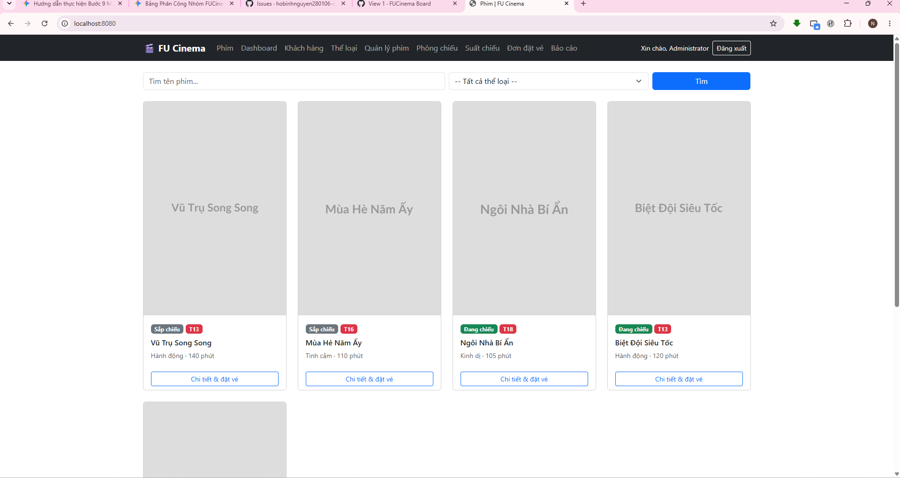
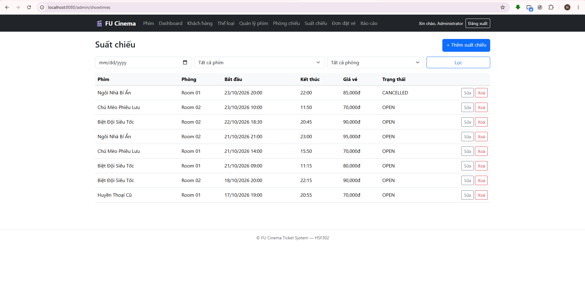
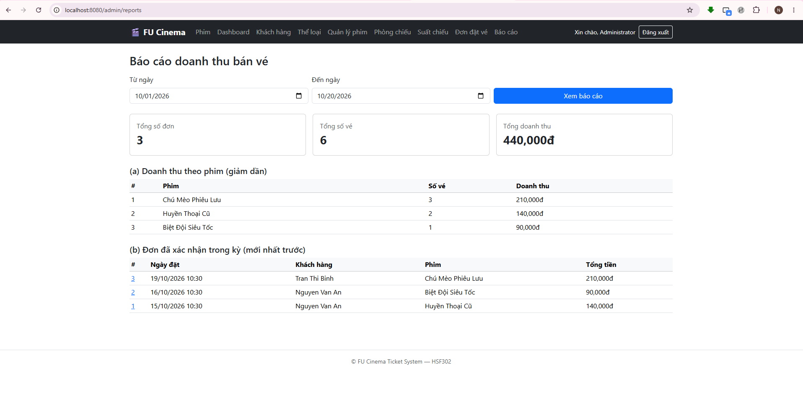

# FU Cinema Ticket System

Website quản lý & bán vé xem phim — Assignment môn **HSF302**.

## Công nghệ sử dụng
- **Backend:** Java 21, Spring Boot 4.1.x, Spring Data JPA (Hibernate 7), Bean Validation
- **Database:** Microsoft SQL Server (database `FUCinemaTicketDB`, cấu hình `ddl-auto=update`)
- **Kiến trúc:** 3-Layer Architecture (`controller` → `service` → `repository` → `entity`)
- **Bảo mật & Phiên làm việc:** Session-based Authentication (`HttpSession`), phân quyền đường dẫn qua `HandlerInterceptor`, mã hóa mật khẩu một chiều với BCrypt (`spring-security-crypto`)
- **Frontend:** Thymeleaf template engine kết hợp Bootstrap 5 (CDN) và Custom CSS

## Hướng dẫn cài đặt & Chạy dự án
### Yêu cầu môi trường
- JDK 21+
- Apache Maven 3.9+
- Microsoft SQL Server 2019+ (đã bật giao thức TCP/IP trên cổng 1433, hỗ trợ xác thực SQL Server và Windows Authentication)

### Các bước thực hiện
```bash
git clone [https://github.com/](https://github.com/)<org>/fu-cinema-ticket-system.git
cd fu-cinema-ticket-system
```

1. **Tạo Database trong SSMS:**
   ```sql
   CREATE DATABASE FUCinemaTicketDB;
   ```

2. **Cấu hình kết nối cá nhân (không commit lên Git):**
   ```bash
   cp src/main/resources/application-local.properties.example src/main/resources/application-local.properties
   ```
   Mở file `src/main/resources/application-local.properties` và cập nhật đúng thông tin:
   ```properties
   spring.datasource.username=sa
   spring.datasource.password=<mat_khau_sql_server_cua_ban>
   ```

3. **Chạy ứng dụng:**
   ```bash
   mvn spring-boot:run
   ```
   Truy cập: [http://localhost:8080](http://localhost:8080). Ở lần chạy đầu tiên, `DataSeeder` sẽ tự động tạo bảng và nạp bộ dữ liệu thử nghiệm.

4. **Kiểm thử tự động (In-memory H2, không cần bật SQL Server):**
   ```bash
   mvn clean verify
   ```

## Tài khoản mẫu
| Vai trò | Tên đăng nhập (Email) | Mật khẩu | Mục đích kiểm thử |
|---|---|---|---|
| **ADMIN** | `admin@fucinema.vn` | `Admin@123` | Quản trị toàn bộ hệ thống & xem báo cáo |
| **CUSTOMER** | `an.nv@gmail.com` | `Customer@123` | Đặt vé, xem lịch sử, tài khoản người lớn |
| **CUSTOMER** | `binh.tt@gmail.com` | `Customer@123` | Kiểm tra quy tắc chặn độ tuổi BR-11 (15 tuổi, không đặt được phim T16/T18) |

## Chức năng chính
- **Khách vãng lai:** Xem danh sách phim đang chiếu/sắp chiếu, tìm kiếm theo từ khóa, lọc theo thể loại, xem chi tiết & lịch chiếu, đăng nhập/đăng ký tài khoản (xác thực tuổi $\ge 13$).
- **Customer (Khách hàng):** Chọn ghế trực tiếp trên sơ đồ phòng chiếu (tối đa 8 ghế/đơn), khóa giữ chỗ đa luồng chống trùng, xem lịch sử đơn đặt vé, hủy vé hợp lệ trước giờ chiếu $\ge 2$ giờ, cập nhật hồ sơ cá nhân, đổi mật khẩu, đánh giá phim đã xem.
- **Admin (Quản trị viên):** Dashboard tổng quan theo ngày, quản lý khách hàng (khóa/xóa), quản lý thể loại, quản lý phim (soft delete), quản lý phòng chiếu, quản lý suất chiếu (thuật toán chống giao thoa/trùng lịch), duyệt/hủy đơn đặt vé, báo cáo doanh thu theo khoảng thời gian.

## Thành viên & Phân công nhiệm vụ (Nhóm 3 người)
| STT | Mã SV | Họ và tên | Vai trò | Module & Nhiệm vụ đảm nhận | TODO |
|:---:|:---:|---|:---:|---|:---:|
| 1 | **DE200093** | **Hồ Bình Nguyên** | Leader (A) | Setup dự án, DB config, layout base Thymeleaf, toàn bộ 9 Entity, Repository skeleton, Seed data, Exception Handler tập trung, Auth & Interceptor phân quyền, Báo cáo thống kê Admin, Dashboard, Smoke test, README & Release v1.0.0 | 1–4, 7, 8–15, 26, 32 |
| 2 | *(Mã SV B)* | **Lê Công Đức Nghĩa** | Dev (B) | Quản lý Khách hàng (Admin: CRUD, Lock, Delete), Quản lý Thể loại, Quản lý Phim (CRUD, lọc tìm kiếm, Soft Delete), Trang chủ & Chi tiết phim, Hồ sơ & Đổi mật khẩu, Đánh giá phim đã xem | 5, 16–21, 27, 30, 31 |
| 3 | *(Mã SV C)* | **Lê Võ Quang Vinh** | Dev (C) | Quản lý Phòng chiếu (CRUD, sức chứa), Quản lý Suất chiếu (CRUD, check trùng giờ, hủy suất), Quản lý Đơn đặt vé Admin, Sơ đồ ghế & Đặt vé đa luồng (`PESSIMISTIC_WRITE`), Lịch sử & Hủy vé Customer | 6, 22–25, 28, 29 |

## Ảnh chụp màn hình giao diện
| Màn hình | Ảnh chụp |
|---|---|
| **Trang chủ danh sách phim** |  |
| **Sơ đồ chọn ghế đặt vé** |  |
| **Quản lý suất chiếu Admin** |  |
| **Báo cáo doanh thu Admin** |  |

## Quy trình làm việc nhóm
Áp dụng mô hình **Git Flow** rút gọn (`main` ← `release/*` ← `develop` ← `feature/*`, `docs/*`), chuẩn **Conventional Commits**, mọi thay đổi được rà soát chéo (Code Review) và hợp nhất qua Pull Request (Squash and Merge).


# FU Cinema Ticket System — Desktop Application (v2.0.0)

Hệ thống quản lý và bán vé xem phim tại quầy dành cho nhân viên/quản trị viên rạp chiếu phim FU Cinema, phát triển trên nền tảng **JavaFX** tích hợp backend **Spring Boot** và cơ sở dữ liệu **Microsoft SQL Server**.

---

## 1. Yêu cầu hệ thống

- **Java Development Kit (JDK):** Version 21 trở lên
- **Hệ điều hành:** Windows 10/11, macOS hoặc Linux (có hỗ trợ giao diện đồ họa GUI)
- **Cơ sở dữ liệu:** Microsoft SQL Server (sử dụng cùng schema `FUCinemaTicketDB` đã cấu hình ở phần Web)
- **Công cụ xây dựng:** Apache Maven 3.8+
- **IDE khuyến nghị:** IntelliJ IDEA (cài đặt plugin *Lombok* và hỗ trợ *JavaFX*)

---

## 2. Hướng dẫn khởi chạy ứng dụng

### Chạy bằng IntelliJ IDEA
1. Mở dự án trong IntelliJ IDEA và đợi Maven tải đầy đủ dependencies.
2. Tìm đến class:  
   `src/main/java/com/fu/cinema/desktop/DesktopLauncher.java`
3. Nhấp chuột phải chọn **Run 'DesktopLauncher.main()'**.

### Chạy thông qua dòng lệnh Maven
Mở Terminal tại thư mục gốc của dự án và chạy lệnh:
```bash
mvn spring-boot:run -Dspring-boot.run.main-class=com.fu.cinema.desktop.DesktopLauncher
```

### Chạy song song cả hai nền tảng (Web & Desktop)
- Mở **Terminal 1** (chạy cổng Web):
  ```bash
  mvn spring-boot:run
  ```
- Mở **Terminal 2** (chạy Desktop App):
  ```bash
  mvn spring-boot:run -Dspring-boot.run.main-class=com.fu.cinema.desktop.DesktopLauncher
  ```

---

## 3. Tài khoản đăng nhập hệ thống

Hệ thống Desktop áp dụng cơ chế xác thực phân quyền nghiêm ngặt, **chỉ cho phép tài khoản quản trị viên (`ADMIN`) truy cập**:

| Vai trò | Email đăng nhập | Mật khẩu mặc định | Ghi chú |
| :--- | :--- | :--- | :--- |
| **Quản trị viên (Admin)** | `admin@fucinema.vn` | `Admin@123` | Cho phép truy cập toàn quyền quầy vé |
| **Khách hàng (Customer)** | `an.nv@gmail.com` | `Customer@123` | Bị từ chối truy cập (Quy tắc BR-D1) |

---

## 4. Danh sách các phân hệ chức năng & Màn hình

1. **Đăng nhập (`login.fxml`):**
    - Xác thực tài khoản Admin qua `AuthFacade`.
    - Quản lý phiên làm việc thông qua `DesktopSession`.
    - Ngăn chặn người dùng vai trò Customer đăng nhập vào quầy vé.

2. **Dashboard (`dashboard.fxml`):**
    - Thống kê 3 chỉ số KPI theo thời gian thực: *Phim đang chiếu*, *Tổng số khách hàng*, *Đơn đặt vé chờ duyệt*.
    - Biểu đồ cột `BarChart` thống kê mật độ suất chiếu trong ngày theo phòng chiếu.
    - Cơ chế tự động làm mới (`auto-refresh`) định kỳ mỗi 60 giây và dọn dẹp bộ nhớ khi rời Scene.

3. **Quản lý Thể loại & Phim (`genre.fxml`, `movie.fxml`, `movie-dialog.fxml`):**
    - Xem danh sách phim dạng bảng, lọc phim theo tên, thể loại và trạng thái phát hành.
    - Phân trang dữ liệu linh hoạt thông qua record `PageResult`.
    - Thêm mới, chỉnh sửa thông tin chi tiết phim qua Dialog popup.

4. **Quản lý Phòng chiếu & Lịch chiếu (`schedule.fxml`):**
    - Tra cứu suất chiếu theo ngày chiếu và theo phòng.
    - Thao tác đóng/mở bán vé cho từng khung giờ chiếu cụ thể.

5. **Bán vé tại quầy POS (`counter-sale.fxml`):**
    - Giao diện sơ đồ ghế tương tác trực quan: ghế thường, ghế VIP, ghế đã đặt.
    - Tự động tính toán tổng số tiền thanh toán theo thời gian thực.
    - Khởi tạo đơn đặt vé trực tiếp tại quầy và in/xác nhận vé.

6. **Báo cáo Doanh thu & Trích xuất File (`report.fxml`):**
    - Bộ lọc khoảng thời gian với ràng buộc ngày hợp lệ (Từ ngày $\le$ Đến ngày).
    - Trực quan hóa dữ liệu bằng biểu đồ doanh thu theo phim (`BarChart`) và cơ cấu tỷ lệ vé (`PieChart`).
    - Xuất dữ liệu báo cáo ra file định dạng `.csv` chuẩn mã hóa `UTF-8 BOM` (`\uFEFF`), mở đọc chuẩn font tiếng Việt trên Microsoft Excel.

---

## 5. Kết quả kiểm thử (Test Automation)

Bộ kiểm thử tích hợp tại `src/test/java/com/fu/cinema/desktop/DesktopFacadeTest.java` sử dụng `@SpringBootTest` kết hợp cơ sở dữ liệu in-memory H2 (Active Profile `test`):

```bash
mvn test -Dtest=DesktopFacadeTest
```

| Mã kiểm thử | Phương thức kiểm thử | Mục đích & Ràng buộc nghiệp vụ | Kết quả |
| :---: | :--- | :--- | :---: |
| **TC-D01** | `customerAccount_cannotLoginDesktop` | Chặn tài khoản Customer đăng nhập Desktop (BR-D1) | **PASSED** |
| **TC-D02** | `adminAccount_canLogin` | Cho phép tài khoản Admin đăng nhập hợp lệ | **PASSED** |
| **TC-D03** | `movieRows_areMappedInsideTransaction` | Ánh xạ DTO bên trong Transaction, chống lỗi `LazyInitializationException` | **PASSED** |
| **TC-D04** | `bookingRows_haveCustomerAndMovie` | Kiểm tra tính đầy đủ của thông tin khách hàng và phim trong đơn vé | **PASSED** |
| **TC-D05** | `writeOperation_requiresAdminSession` | Bắt buộc phải có phiên đăng nhập Admin hợp lệ khi thực hiện xóa/sửa | **PASSED** |

---

## 6. Phân công nhiệm vụ thành viên (Work Breakdown)

| Thành viên | Trách nhiệm & Phân hệ phụ trách | Danh sách Pull Requests |
| :--- | :--- | :--- |
| **Hồ Bình Nguyên** *(Leader)* | **Kiến trúc nền tảng, Tiện ích, Phiên làm việc, Dashboard, Báo cáo & Release:**<br>- Thiết lập khung kiến trúc, FxAsync, AlertUtil, FxValidator, MoneyUtil (TODO 34, 35)<br>- Quản lý phiên làm việc DesktopSession & Màn hình Login (TODO 36)<br>- Màn hình Dashboard, KPI cards & Biểu đồ phòng chiếu (TODO 37)<br>- Màn hình Báo cáo doanh thu & Xuất file CSV UTF-8 (TODO 45)<br>- Tích hợp Facade Test, đóng gói tài liệu & Release v2.0.0 (TODO 46) | `#34`, `#35`, `#36`, `#37`, `#45`, `#46` |
| **Lê Công Đức Nghĩa** | **Quản lý Danh mục & Đơn đặt vé:**<br>- Quản lý danh mục Thể loại phim (TODO 38)<br>- Quản lý danh sách Phim, tìm kiếm và phân trang (TODO 39)<br>- Dialog thêm/sửa thông tin chi tiết phim (TODO 40)<br>- Tra cứu, tìm kiếm và xem danh sách Đơn đặt vé (TODO 44) | `#38`, `#39`, `#40`, `#44` |
| **Lê Võ Quang Vinh** | **Quản lý Suất chiếu & Bán vé tại quầy (POS):**<br>- Quản lý Phòng chiếu & Lịch chiếu phim (TODO 41)<br>- Thiết kế Sơ đồ ghế tương tác trực quan (TODO 42)<br>- Quy trình Bán vé tại quầy và xác nhận thanh toán (TODO 43) | `#41`, `#42`, `#43` |

---

## 7. Ghi chú phát hành phiên bản (Release Note v2.0.0)

- **Phiên bản:** `v2.0.0`
- **Tên phát hành:** *FU Cinema Desktop Application — Official Release*
- **Các bổ sung cốt lõi:**
    - Hoàn thiện 100% các phân hệ Desktop giao tiếp qua kiến trúc Facade Pattern.
    - Xử lý bất đồng bộ đa luồng với `FxAsync` giúp giao diện không bị giật/lag.
    - Định dạng hiển thị tiền tệ chuẩn VND và bộ xuất báo cáo CSV chống lỗi font.