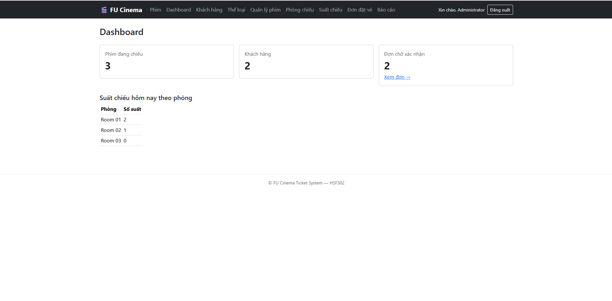
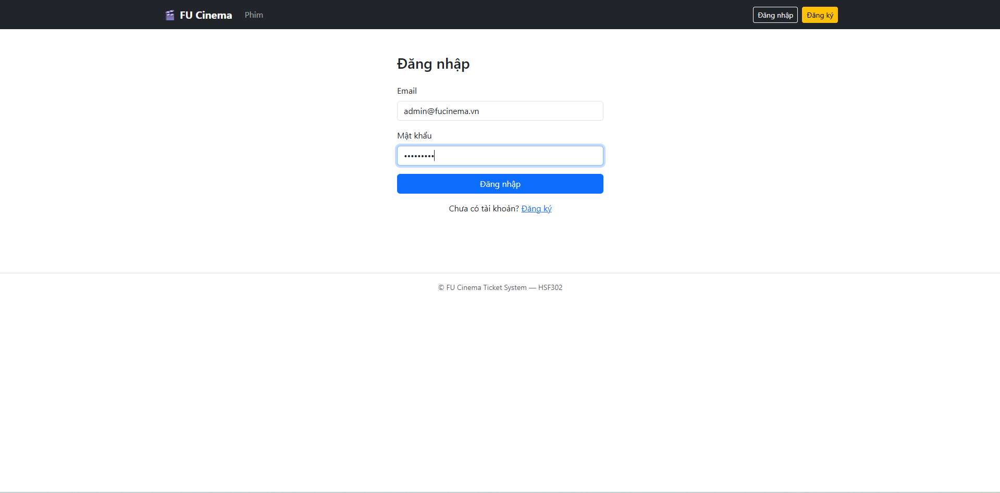

# FU Cinema Ticket System (FUCinemaTicketSystem)

> Hệ thống website quản lý và đặt vé xem phim trực tuyến — Dự án môn học **HSF302**.  
> Xây dựng theo kiến trúc **3-Layer + Repository Pattern** sử dụng **Spring Boot**, **Spring Data JPA**, **Thymeleaf**, và **Microsoft SQL Server**.

---

## 🛠 Công nghệ sử dụng

- **Ngôn ngữ:** Java 17 / 21
- **Framework & Thư viện:**
    - Spring Boot 3.3.x (Spring Web, Spring Data JPA, Spring Validation)
    - Spring Security Crypto (Mã hóa mật khẩu BCrypt)
    - Thymeleaf & Thymeleaf Extras
    - Bootstrap 5.3 & Bootstrap Icons
    - Lombok
- **Cơ sở dữ liệu:** Microsoft SQL Server (H2 Database cho profile `test`)
- **Build tool:** Apache Maven 3.9+
- **VCS & Quy trình:** Git, GitHub Flow (Conventional Commits, Branching Strategy)

---

## 🚀 Hướng dẫn cài đặt & khởi chạy


### Các bước cài đặt chi tiết
1. **Clone repository về máy cục bộ:**
   ```bash
   git clone https://github.com/<your-org>/fu-cinema-ticket-system.git
   cd fu-cinema-ticket-system
   ```

2. **Khởi tạo cơ sở dữ liệu trên SQL Server:**
   Mở SQL Server Management Studio (SSMS) và thực thi lệnh:
   ```sql
   CREATE DATABASE FUCinemaTicketDB;
   ```

3. **Cấu hình kết nối cục bộ (Local Profile):**
   Copy file cấu hình mẫu sang file cấu hình cá nhân:
   ```bash
   cp src/main/resources/application-local.properties.example src/main/resources/application-local.properties
   ```
   Mở file `src/main/resources/application-local.properties` và điền tài khoản `sa` cùng mật khẩu SQL Server của máy bạn:
   ```properties
   spring.datasource.url=jdbc:sqlserver://localhost:1433;databaseName=FUCinemaTicketDB;encrypt=true;trustServerCertificate=true
   spring.datasource.username=sa
   spring.datasource.password=YOUR_SQL_PASSWORD
   ```
   *(Lưu ý: File `application-local.properties` đã được cấu hình trong `.gitignore`, tuyệt đối không commit lên Git).*

4. **Biên dịch và chạy ứng dụng:**
   ```bash
   mvn spring-boot:run
   ```
   Sau khi console báo khởi động thành công (`Tomcat started on port 8080`), truy cập hệ thống tại:  
   👉 **http://localhost:8080**

5. **Dữ liệu khởi tạo ban đầu:**
   Khi chạy lần đầu trên database rỗng, `DataSeeder` sẽ tự động khởi tạo dữ liệu mẫu bao gồm tài khoản, thể loại, phim, phòng, suất chiếu và đơn vé giả lập tương đối theo ngày hiện tại.

---

## 👥 Tài khoản thử nghiệm (Seed Data)

| Vai trò | Email / Username | Mật khẩu | Ghi chú |
|---|---|---|---|
| **Admin** | `admin@fucinema.vn` | `Admin@123` | Quản trị toàn quyền hệ thống |
| **Customer** | `an.nv@gmail.com` | `Customer@123` | Khách hàng đã đủ 18 tuổi |
| **Customer (15 tuổi)** | `binh.tt@gmail.com` | `Customer@123` | Dùng để kiểm thử ràng buộc phim giới hạn độ tuổi (T16, T18) |

---

## 👨‍💻 Phân công thành viên (Mô hình 3 người)

| Thành viên | MSSV | Vai trò | Chức năng phụ trách chính |
|---|---|---|---|
| **Hồ Bình Nguyên** | DE200093 | **Leader** | • **Hạ tầng & Nền tảng:** Khởi tạo dự án, toàn bộ 10 Entity & 8 Enum, Repository & Custom Queries khung, DataSeeder, Base Layout, Error Handling (403/404/500).<br>• **Xác thực:** Đăng nhập, đăng ký, đăng xuất, phân quyền bằng `HandlerInterceptor`.<br>• **Admin:** Báo cáo doanh thu theo kỳ (StartDate → EndDate, Q7, Q8), Admin Dashboard.<br>• **Đóng gói:** Hoàn thiện tài liệu, smoke test H2, release v1.0.0. *(TODO 1–4, 7 Review, 8–15, 26, 32)* |
| **Lê Công Đức Nghĩa** | DE201004 | **Member** | • **Admin Quản lý Khách hàng:** CRUD khách hàng, tìm kiếm/lọc phân trang, toggle khoá tài khoản, xoá theo BR-04.<br>• **Admin Quản lý Phim & Thể loại:** CRUD Thể loại (chặn xoá BR-05), Quản lý phim kèm lọc đa tiêu chí, xoá mềm (chuyển STOPPED theo BR-06).<br>• **Khách hàng:** Trang chủ, xem chi tiết phim & suất chiếu sắp tới, hồ sơ cá nhân, đổi mật khẩu, đánh giá phim (Bonus BR-16). *(TODO 5, 16–21, 27, 30, 31)* |
| **Lê Võ Quang Vinh** | DE201004 | **Member** | • **Admin Quản lý Phòng & Lịch chiếu:** CRUD Phòng chiếu, Quản lý suất chiếu kèm thuật toán kiểm tra trùng lịch Q3 (BR-07, BR-08), huỷ suất chiếu kèm huỷ đơn hàng loạt Q9 (BR-09).<br>• **Admin Quản lý Đặt vé:** Xem danh sách đơn vé kèm bộ lọc, xem chi tiết (chống Lazy Loading), duyệt và huỷ đơn.<br>• **Khách hàng Đặt vé:** Giao diện chọn ghế ngồi trực quan, tính tiền tự động, kiểm tra tuổi (BR-11), khoá bi quan (Pessimistic lock) chống trùng ghế, lịch sử vé và huỷ vé trước 2h (BR-14). *(TODO 6, 22–25, 28, 29)* |

---

## Ảnh màn hình




