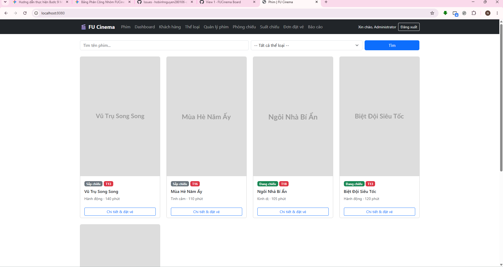
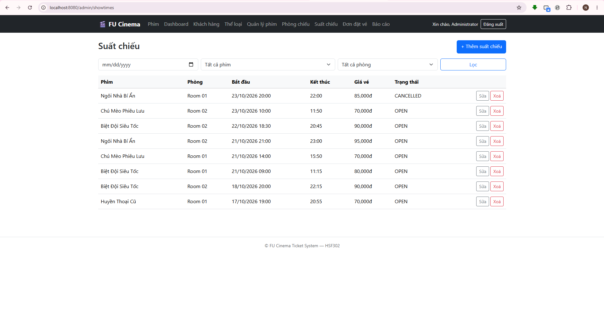
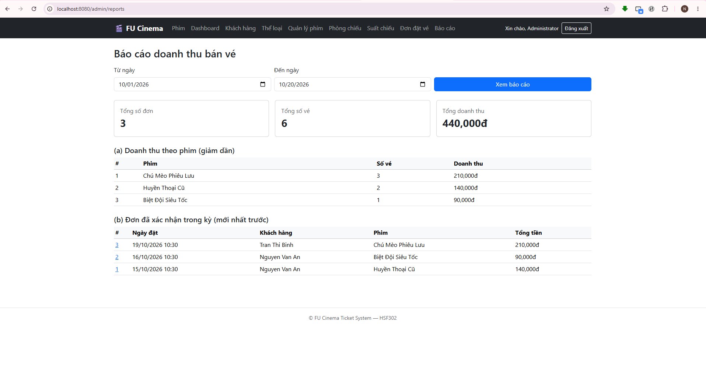

# FU Cinema Ticket System

Website quản lý & bán vé xem phim — Assignment môn **HSF302**.

## Công nghệ sử dụng
- **Backend:** Java 21, Spring Boot 4.1.x, Spring Data JPA (Hibernate 7), Bean Validation
- **Database:** Microsoft SQL Server (database `FUCinemaTicketDB`, cấu hình `ddl-auto=update`)
- **Kiến trúc:** 3-Layer Architecture (`controller` → `service` → `repository` → `entity`)
- **Bảo mật & Phiên làm việc:** Session-based Authentication (`HttpSession`), phân quyền đường dẫn qua `HandlerInterceptor`, mã hóa mật khẩu một chiều với BCrypt (`spring-security-crypto`)
- **Frontend:** Thymeleaf template engine kết hợp Bootstrap 5 (CDN) và Custom CSS

## Hướng dẫn cài đặt & Chạy dự án
### Yêu cầu môi trường
- JDK 21+
- Apache Maven 3.9+
- Microsoft SQL Server 2019+ (đã bật giao thức TCP/IP trên cổng 1433, hỗ trợ xác thực SQL Server và Windows Authentication)

### Các bước thực hiện
```bash
git clone [https://github.com/](https://github.com/)<org>/fu-cinema-ticket-system.git
cd fu-cinema-ticket-system
```

1. **Tạo Database trong SSMS:**
   ```sql
   CREATE DATABASE FUCinemaTicketDB;
   ```

2. **Cấu hình kết nối cá nhân (không commit lên Git):**
   ```bash
   cp src/main/resources/application-local.properties.example src/main/resources/application-local.properties
   ```
   Mở file `src/main/resources/application-local.properties` và cập nhật đúng thông tin:
   ```properties
   spring.datasource.username=sa
   spring.datasource.password=<mat_khau_sql_server_cua_ban>
   ```

3. **Chạy ứng dụng:**
   ```bash
   mvn spring-boot:run
   ```
   Truy cập: [http://localhost:8080](http://localhost:8080). Ở lần chạy đầu tiên, `DataSeeder` sẽ tự động tạo bảng và nạp bộ dữ liệu thử nghiệm.

4. **Kiểm thử tự động (In-memory H2, không cần bật SQL Server):**
   ```bash
   mvn clean verify
   ```

## Tài khoản mẫu
| Vai trò | Tên đăng nhập (Email) | Mật khẩu | Mục đích kiểm thử |
|---|---|---|---|
| **ADMIN** | `admin@fucinema.vn` | `Admin@123` | Quản trị toàn bộ hệ thống & xem báo cáo |
| **CUSTOMER** | `an.nv@gmail.com` | `Customer@123` | Đặt vé, xem lịch sử, tài khoản người lớn |
| **CUSTOMER** | `binh.tt@gmail.com` | `Customer@123` | Kiểm tra quy tắc chặn độ tuổi BR-11 (15 tuổi, không đặt được phim T16/T18) |

## Chức năng chính
- **Khách vãng lai:** Xem danh sách phim đang chiếu/sắp chiếu, tìm kiếm theo từ khóa, lọc theo thể loại, xem chi tiết & lịch chiếu, đăng nhập/đăng ký tài khoản (xác thực tuổi $\ge 13$).
- **Customer (Khách hàng):** Chọn ghế trực tiếp trên sơ đồ phòng chiếu (tối đa 8 ghế/đơn), khóa giữ chỗ đa luồng chống trùng, xem lịch sử đơn đặt vé, hủy vé hợp lệ trước giờ chiếu $\ge 2$ giờ, cập nhật hồ sơ cá nhân, đổi mật khẩu, đánh giá phim đã xem.
- **Admin (Quản trị viên):** Dashboard tổng quan theo ngày, quản lý khách hàng (khóa/xóa), quản lý thể loại, quản lý phim (soft delete), quản lý phòng chiếu, quản lý suất chiếu (thuật toán chống giao thoa/trùng lịch), duyệt/hủy đơn đặt vé, báo cáo doanh thu theo khoảng thời gian.

## Thành viên & Phân công nhiệm vụ (Nhóm 3 người)
| STT | Mã SV | Họ và tên | Vai trò | Module & Nhiệm vụ đảm nhận | TODO |
|:---:|:---:|---|:---:|---|:---:|
| 1 | **DE200093** | **Hồ Bình Nguyên** | Leader (A) | Setup dự án, DB config, layout base Thymeleaf, toàn bộ 9 Entity, Repository skeleton, Seed data, Exception Handler tập trung, Auth & Interceptor phân quyền, Báo cáo thống kê Admin, Dashboard, Smoke test, README & Release v1.0.0 | 1–4, 7, 8–15, 26, 32 |
| 2 | *(Mã SV B)* | **Lê Công Đức Nghĩa** | Dev (B) | Quản lý Khách hàng (Admin: CRUD, Lock, Delete), Quản lý Thể loại, Quản lý Phim (CRUD, lọc tìm kiếm, Soft Delete), Trang chủ & Chi tiết phim, Hồ sơ & Đổi mật khẩu, Đánh giá phim đã xem | 5, 16–21, 27, 30, 31 |
| 3 | *(Mã SV C)* | **Lê Võ Quang Vinh** | Dev (C) | Quản lý Phòng chiếu (CRUD, sức chứa), Quản lý Suất chiếu (CRUD, check trùng giờ, hủy suất), Quản lý Đơn đặt vé Admin, Sơ đồ ghế & Đặt vé đa luồng (`PESSIMISTIC_WRITE`), Lịch sử & Hủy vé Customer | 6, 22–25, 28, 29 |

## Ảnh chụp màn hình giao diện
| Màn hình | Ảnh chụp |
|---|---|
| **Trang chủ danh sách phim** |  |
| **Sơ đồ chọn ghế đặt vé** |  |
| **Quản lý suất chiếu Admin** |  |
| **Báo cáo doanh thu Admin** |  |

## Quy trình làm việc nhóm
Áp dụng mô hình **Git Flow** rút gọn (`main` ← `release/*` ← `develop` ← `feature/*`, `docs/*`), chuẩn **Conventional Commits**, mọi thay đổi được rà soát chéo (Code Review) và hợp nhất qua Pull Request (Squash and Merge).